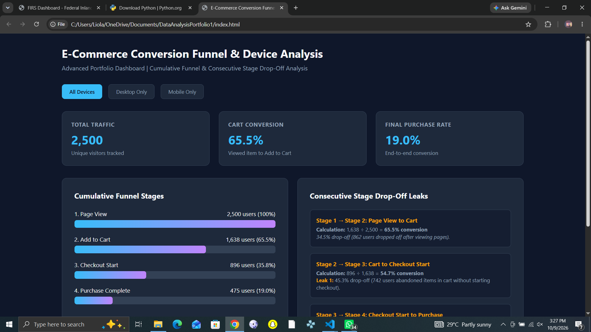

# 📊 E-Commerce Conversion Funnel & Device Performance Analysis

An end-to-end data analysis portfolio project investigating e-commerce
conversion funnel drop-offs, comparing device-level performance, and
identifying opportunities to improve the customer purchasing experience.

The project combines Python-based data analysis with an interactive
HTML, CSS, and JavaScript dashboard to communicate actionable business insights.

---

## 🖥️ Interactive Dashboard Preview

The interactive analytics dashboard built with HTML5, CSS3, and JavaScript, featuring real-time device filtering and dynamic metric updates.

## 🔍 1. Business Problem

E-commerce businesses need to understand where potential customers
abandon their purchasing journey to identify opportunities to improve
conversion rates and sales performance.

This project investigates the following business questions:

- What percentage of visitors progress through each stage of the
  purchasing funnel?
- At which stages do the largest customer drop-offs occur?
- How do purchase conversion rates differ between mobile and desktop users?
- What areas require further investigation to improve conversion performance?

The objective is to transform user activity data into meaningful
insights that can support evidence-based business decisions.

---

## 🛠️ 2. Data & Tools Used

### Tools and Technologies

- *Python:* Data analysis and processing
- *Pandas:* Data manipulation and analysis
- *NumPy:* Numerical calculations
- *HTML5:* Dashboard structure
- *CSS3:* Dashboard styling
- *JavaScript:* Interactive dashboard functionality

### Dataset Overview

The analysis uses two datasets:

| Dataset | Description | Records |
|---|---|---:|
| ecommerce_users.csv | User profiles, including device type and acquisition channel | 2,500 |
| ecommerce_events.csv | Event records tracking user activity and funnel progression | 5,509 |

The datasets were combined to analyse user behaviour across the
purchasing funnel and compare conversion performance by device.

*Dataset note:* Specify whether the data is simulated or sourced
from a real-world dataset, and provide the source where applicable.

---

## 🧹 3. Data Cleaning & Validation

The following data-quality checks were performed during preparation:

- Checked for missing values in key identifiers, including
  user_id, session_id, and timestamps.
- Investigated potential duplicate event records using relevant identifiers.
- Validated the relationships between user profile records and event logs.
- Compared record counts before and after merging the datasets.
- Verified funnel calculations against the underlying event records.

These checks helped assess data quality and ensure that the funnel
metrics were calculated consistently.

---

## 📈 4. Key Findings: Conversion Funnel Analysis

### 4.1 Cumulative Funnel Performance

The cumulative funnel measures the percentage of initial visitors
who reached each subsequent stage.

| Funnel Stage | Users | Conversion from Initial Visitors |
|---|---:|---:|
| Page View | 2,500 | 100.0% |
| Add to Cart | 1,638 | 65.5% |
| Checkout Started | 896 | 35.8% |
| Purchase Completed | 475 | 19.0% |

The overall purchase conversion rate was *19.0%*, meaning that
475 of the 2,500 visitors completed a purchase.

### 4.2 Consecutive Stage Conversion & Drop-Off

This analysis measures the percentage of users progressing from
one funnel stage to the next.

| Funnel Transition | Users Entering Stage | Users Progressing | Users Lost | Conversion Rate | Drop-Off Rate |
|---|---:|---:|---:|---:|---:|
| Page View → Add to Cart | 2,500 | 1,638 | 862 | 65.5% | 34.5% |
| Add to Cart → Checkout Started | 1,638 | 896 | 742 | 54.7% | 45.3% |
| Checkout Started → Purchase Completed | 896 | 475 | 421 | 53.0% | 47.0% |

#### Key Observations

*1. Product Engagement*

Of the 2,500 visitors, 1,638 added an item to their cart.
The remaining 862 visitors did not progress to the add-to-cart stage.

*2. Cart-to-Checkout Drop-Off*

Of the 1,638 users who added items to their carts, 896 proceeded
to checkout.

This represents a 45.3% drop-off rate between adding items to
the cart and starting checkout.

*3. Checkout Abandonment*

Of the 896 users who started checkout, 475 completed their purchases,
while 421 did not reach the purchase-complete stage.

The checkout completion rate was 53.0%, with a corresponding
drop-off rate of 47.0%.

Further investigation is required to determine the reasons for
abandonment at this stage.

---

## 5. Granular Device Performance Analysis

To identify where desktop and mobile conversion performance begins to differ, the funnel was segmented by device category across all four stages.

### Device Sample Sizes

- *Desktop Users:* 875 unique visitors (35% of total traffic).
- *Mobile Users:* 1,625 unique visitors (65% of total traffic).

### Stage-by-Stage Device Funnel Comparison

The conversion rates below represent the percentage of visitors on each device who reached each funnel stage, using the initial visitor count for that device as the denominator.

| Funnel Stage | Desktop Users | Desktop Conversion | Mobile Users | Mobile Conversion | Difference (Mobile - Desktop) |
|---|---:|---:|---:|---:|---:|
| Page View | 875 | 100.0% | 1,625 | 100.0% | 0.0 percentage points |
| Add to Cart | 564 | 64.5% | 1,074 | 66.1% | +1.6 percentage points |
| Checkout Started | 315 | 36.0% | 581 | 35.8% | -0.2 percentage points |
| Purchase Completed | 228 | 26.1% | 247 | 15.2% | -10.9 percentage points |

Note: Rates are rounded to one decimal place.

### Key Analytical Insight

Desktop and mobile users show relatively similar cumulative conversion rates through the checkout initiation stage. However, a substantial difference appears at the final purchase stage.

Desktop visitors have a purchase conversion rate of *26.1%, compared with **15.2% for mobile visitors—a difference of **10.9 percentage points*.

This suggests that the transition from checkout initiation to completed purchase warrants further investigation. However, the available data does not establish why this difference exists.

### Checkout Completion Analysis

To examine the final funnel transition more closely, checkout completion was calculated using the number of checkout starters on each device as the denominator.

| Checkout Metric | Desktop | Mobile |
|---|---:|---:|
| Checkout Starters | 315 | 581 |
| Completed Purchases | 228 | 247 |
| Checkout Starters Who Did Not Complete a Purchase | 87 | 334 |
| Checkout Completion Rate | 72.4% | 42.5% |
| Checkout Drop-Off Rate | 27.6% | 57.5% |

*Key Finding:* Desktop users complete checkout at a rate of 72.4%, compared with 42.5% for mobile users. The difference is approximately *29.9 percentage points*.

Although more mobile users enter checkout, a smaller proportion complete their purchases. This makes the mobile checkout-to-purchase transition a priority for further investigation.

Important distinction: Users who started checkout but did not complete a purchase should not automatically be classified as users who experienced payment failures. The available event data only establishes that a purchase was not recorded.

### Potential Factors to Investigate

The observed difference in device performance may be associated with several factors that require further analysis.

- *Traffic Acquisition Channels:* Compare conversion rates across paid, organic, referral, and other acquisition channels to determine whether differences in traffic composition contribute to the observed gap.
- *Product Categories and User Behaviour:* Investigate whether mobile and desktop users browse different product categories, exhibit different browsing patterns, or show different levels of purchase intent.
- *Mobile Checkout Usability:* Evaluate the mobile checkout experience, including form-field usability, page loading speed, navigation, and the number of steps required to complete a purchase.
- *Technical Performance:* Examine mobile-specific errors, payment processing issues, and failed transactions if suitable technical logs or payment data are available.
- *Statistical Uncertainty:* Where the data and sampling assumptions permit, use confidence intervals or a two-proportion test to assess whether the observed conversion-rate difference is statistically significant.

### Limitations

This analysis is descriptive and identifies an association between device category and purchase conversion. It does not establish that device type directly causes the observed difference.

Further investigation is needed to determine whether the gap is related to checkout usability, technical issues, traffic composition, user intent, or other factors. The analysis should also ensure that users are counted consistently across funnel stages and that repeat visits or sessions do not distort the comparisons.

### Conclusion

The device-level analysis identifies the checkout-to-purchase transition as the largest observed difference between desktop and mobile conversion performance. While desktop visitors complete purchases at a higher rate, the underlying reasons remain unconfirmed.

The next step is to investigate the factors associated with mobile checkout drop-off and use the findings to develop and test targeted improvements.

## 💡 6. Business Recommendations & Potential Financial Impact

Based on the observed conversion funnel performance and device-level analysis, the following recommendations aim to identify opportunities for improving the customer journey and increasing completed purchases.

### 1. Investigate Mobile Checkout Performance

Mobile visitors have a purchase conversion rate of 15.2%, compared with 26.1% for desktop visitors. Furthermore, 42.5% of mobile users who started checkout completed a purchase, compared with 72.4% of desktop checkout starters.

These findings suggest that the mobile checkout-to-purchase transition warrants further investigation.

*Recommended actions:*
- Evaluate mobile checkout usability, including form fields, button responsiveness, and navigation.
- Investigate page loading speeds and potential technical errors.
- Review payment processing logs, if available, to identify any device-specific issues.
- Compare mobile conversion rates across traffic acquisition channels and product categories.

The objective is to identify factors associated with mobile checkout drop-off before recommending specific changes.

### 2. Investigate Cart-to-Checkout Drop-Off

Of the 1,638 users who added items to their carts, 896 proceeded to checkout. This means *742 users did not reach the recorded checkout stage*, representing a 45.3% drop-off between adding an item to the cart and starting checkout.

*Recommended actions:*
- Investigate whether unexpected delivery costs or additional fees may discourage users from proceeding.
- Review the visibility and clarity of delivery options.
- Evaluate whether account creation requirements introduce unnecessary friction.
- Examine the transition from the cart page to checkout for usability issues.

These are potential explanations to investigate, not confirmed causes established by the current dataset.

### 3. Scenario-Based Business Impact Calculation

To estimate the potential business impact of improving mobile conversion, a hypothetical target conversion rate of 20% was applied to the existing mobile visitor count.

*Current performance:*

- Total mobile visitors: 1,625
- Completed mobile purchases: 247
- Current mobile purchase conversion rate: 15.2%

*Hypothetical improvement scenario:*

- Target mobile purchase conversion rate: 20.0%
- Estimated purchases at the target rate: 1,625 × 20% = 325
- Current completed purchases: 247
- *Potential additional purchases: 325 − 247 = 78*

Under this scenario, increasing mobile purchase conversion to 20% while maintaining the same visitor volume would result in approximately *78 additional purchases*.

*Assumptions and limitations:*

- The total number of mobile visitors remains fixed at 1,625.
- The 20% conversion rate is a hypothetical target, not a forecast or guaranteed outcome.
- The calculation assumes that the visitor population and purchase-counting methodology remain consistent.
- No monetary revenue estimate is provided because the average order value (AOV) and reporting period have not been established.

If the average order value becomes available, potential additional gross sales could be estimated as:

*Potential Additional Gross Sales = 78 × Average Order Value (AOV)*

This estimate would represent potential gross sales, not profit, and would depend on the conversion improvement actually being achieved.

### 4. Validate Improvements Through A/B Testing

Before implementing checkout changes across the entire website, an A/B test could be used to evaluate whether a revised mobile checkout experience improves purchase conversion.

*Proposed approach:*

1. *Control group:* Users experience the existing mobile checkout process.
2. *Variant group:* Users experience an improved checkout design based on identified usability or technical issues.
3. *Primary metric:* Completed purchases divided by eligible users assigned to each group.
4. *Secondary metrics:* Checkout completion rate, checkout drop-off rate, and checkout loading performance, where measurable.
5. *Evaluation:* Determine the required sample size and test duration before starting the experiment, then assess whether the observed difference is statistically reliable.

The improved checkout should only be rolled out more broadly if the experiment provides sufficient evidence of improvement without introducing other significant problems.

### Conclusion

The analysis identifies two opportunities for further investigation: mobile checkout performance and the transition from cart to checkout.

The scenario-based calculation also demonstrates how a hypothetical improvement in mobile conversion could translate into additional purchases. However, the actual business impact would need to be validated through further analysis and controlled experimentation.

By combining funnel analysis, quantitative scenario modelling, and experimental validation, the business can make more evidence-based decisions about improving conversion performance.

## 🖥️ 7. Interactive Dashboard

The interactive dashboard allows users to explore conversion
performance through the following filters:

- *All Devices:* View overall funnel performance.
- *Desktop Only:* Examine desktop user behaviour.
- *Mobile Only:* Examine mobile user behaviour.

### How to View the Dashboard

1. Download or clone the project repository.
2. Locate the index.html file.
3. Open the file in a web browser.
4. Select the device filters to explore the dashboard.

---

## ⚠️ 8. Limitations

- The analysis identifies observed conversion differences but does
  not establish their underlying causes.
- Additional investigation is needed to understand why users
  abandon individual funnel stages.
- Financial impact cannot be reliably quantified without additional
  business information and clearly defined assumptions.
- The findings depend on the quality, completeness, and consistency
  of the underlying data.

---

## ✅ 9. Conclusion

This project demonstrates how e-commerce funnel analysis and device
segmentation can be used to evaluate customer purchasing behaviour,
identify conversion bottlenecks, and develop evidence-based
recommendations.

The analysis identified substantial drop-offs between funnel stages
and a difference in final purchase conversion between desktop and
mobile users.

These findings provide a foundation for further investigation into
customer abandonment and opportunities to improve the purchasing
experience.

The project combines data analysis, interactive visualisation,
and business interpretation to demonstrate practical analytical
skills.

---